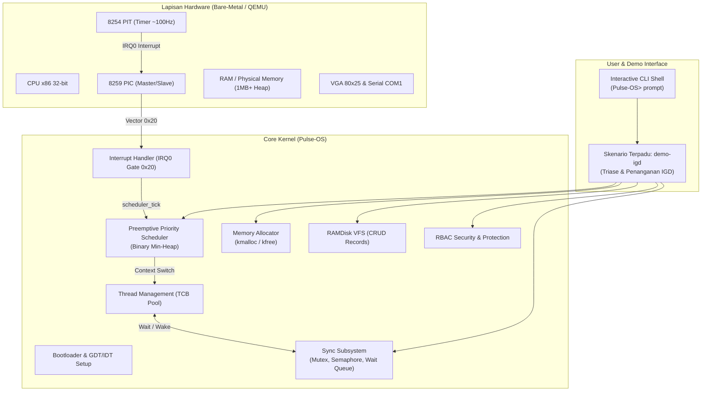
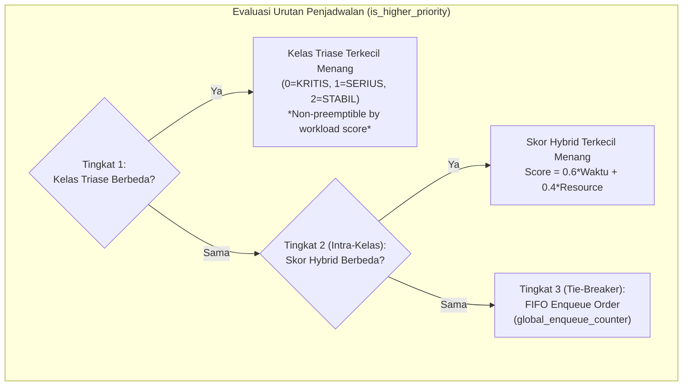
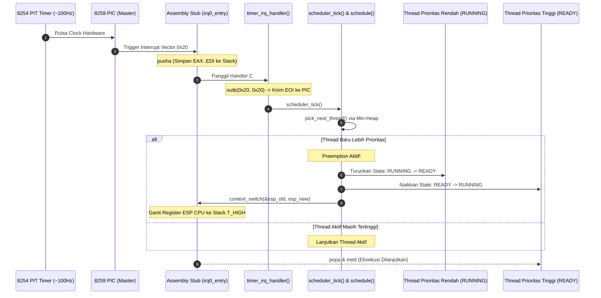
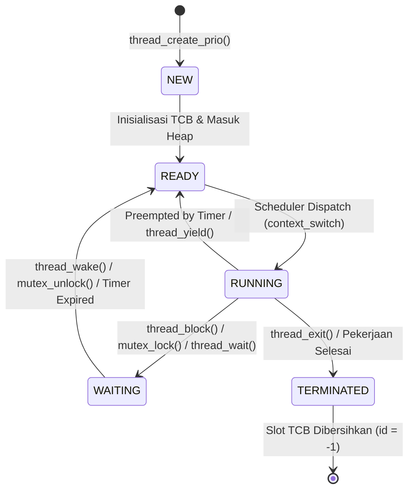
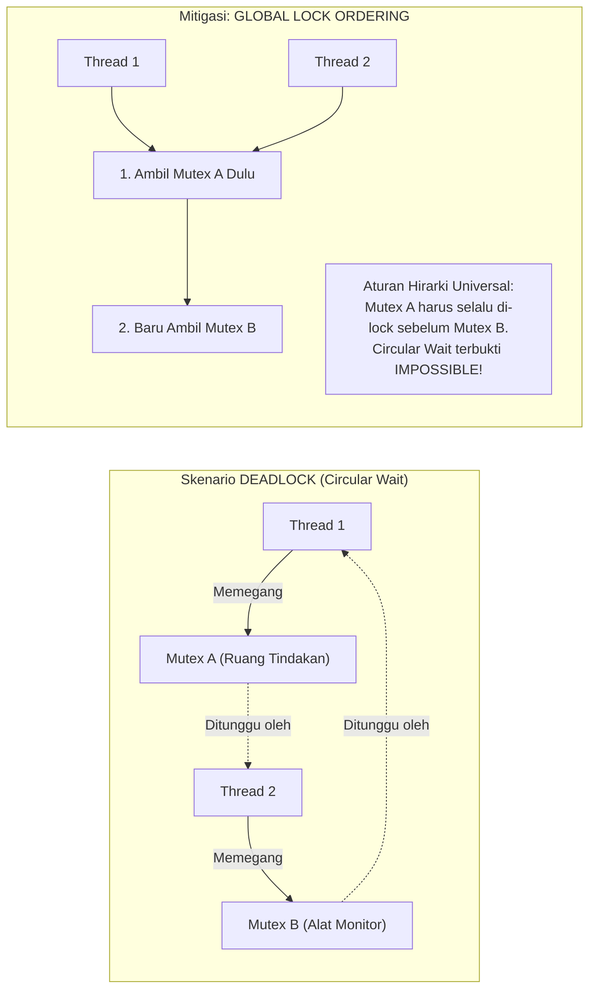
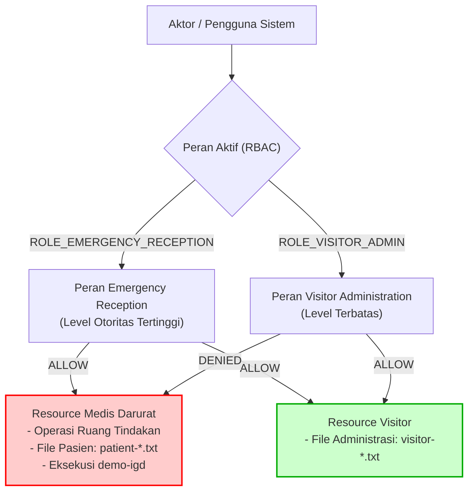
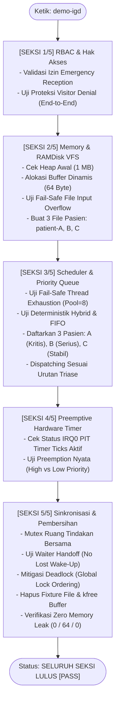
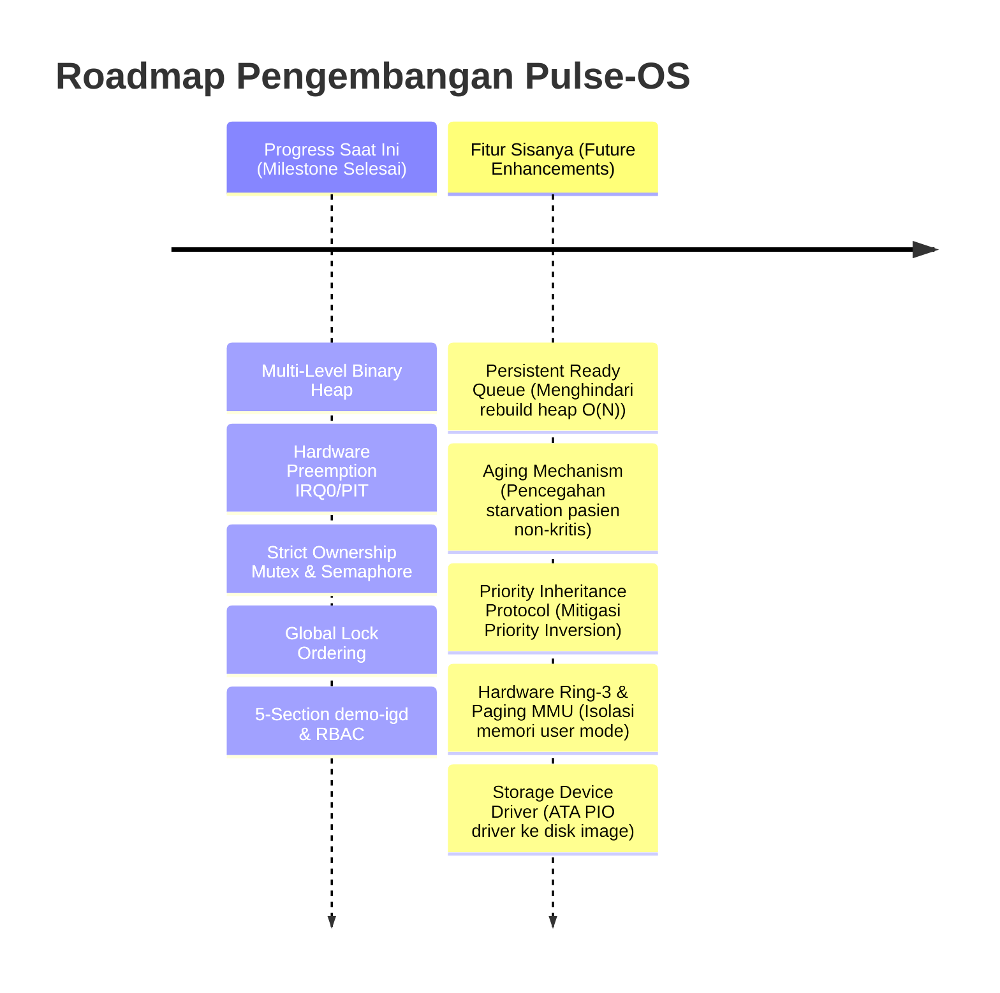

# Slide Deck Presentasi Progress: Pulse-OS
**Tema:** Implementasi Preemptive Priority Queue Scheduler, Sinkronisasi, Deadlock Mitigation, dan Simulasi Terpadu IGD pada Kernel Bare-Metal x86  
**Mata Kuliah:** Sistem Operasi (Tugas Besar Mini-OS)  
**Kelompok / Tim:** Pulse-OS Team (Nijar, Kiran, Qina, Fathir)  

---

## Daftar Isi Slide

1. [Slide 1: Judul & Pengantar Pulse-OS](#slide-1-judul--pengantar-pulse-os)
2. [Slide 2: Arsitektur Umum & Filosofi Pulse-OS](#slide-2-arsitektur-umum--filosofi-pulse-os)
3. [Slide 3: Audit Pemenuhan 8 Syarat Minimum Tugas Besar](#slide-3-audit-pemenuhan-8-syarat-minimum-tugas-besar)
4. [Slide 4: Deep Dive Priority Queue: Multi-Level Hybrid Min-Heap](#slide-4-deep-dive-priority-queue-multi-level-hybrid-min-heap)
5. [Slide 5: Mekanisme Preemptive CPU & Hardware Timer Interrupt (IRQ0/PIT)](#slide-5-mekanisme-preemptive-cpu--hardware-timer-interrupt-irq0pit)
6. [Slide 6: Manajemen Thread & 5 Siklus Hidup (Lifecycle) TCB](#slide-6-manajemen-thread--5-siklus-hidup-lifecycle-tcb)
7. [Slide 7: Primitif Sinkronisasi & Uji Race Condition (Shared Counter)](#slide-7-primitif-sinkronisasi--uji-race-condition-shared-counter)
8. [Slide 8: Demonstrasi Deadlock & Mitigasi Global Lock Ordering](#slide-8-demonstrasi-deadlock--mitigasi-global-lock-ordering)
9. [Slide 9: Memory Allocator Dinamis & Virtual File System (RAMDisk)](#slide-9-memory-allocator-dinamis--virtual-file-system-ramdisk)
10. [Slide 10: Keamanan & Role-Based Access Control (RBAC)](#slide-10-keamanan--role-based-access-control-rbac)
11. [Slide 11: Demo Terpadu IGD (`demo-igd`) — Orkestrasi 5 Seksi Sistem](#slide-11-demo-terpadu-igd-demo-igd--orkestrasi-5-seksi-sistem)
12. [Slide 12: Bukti Eksekusi & Hasil Pengujian Nyata di QEMU](#slide-12-bukti-eksekusi--hasil-pengujian-nyata-di-qemu)
13. [Slide 13: Evaluasi, Keterbatasan, & Fitur Sisanya (Roadmap)](#slide-13-evaluasi-keterbatasan--fitur-sisanya-roadmap)
14. [Slide 14: Pembagian Tugas Tim & Kesimpulan](#slide-14-pembagian-tugas-tim--kesimpulan)

---

<!-- slide -->
## Slide 1: Judul & Pengantar Pulse-OS

```
  ██████╗ ██╗   ██╗██╗     ███████╗███████╗      ██████╗ ███████╗
  ██╔══██╗██║   ██║██║     ██╔════╝██╔════╝     ██╔═══██╗██╔════╝
  ██████╔╝██║   ██║██║     ███████╗█████╗  ███████║   ██║███████╗
  ██╔═══╝ ██║   ██║██║     ╚════██║██╔══╝  ╚════██║   ██║╚════██║
  ██║     ╚██████╔╝███████╗███████║███████╗     ╚██████╔╝███████║
  ╚═╝      ╚═════╝ ╚══════╝╚══════╝╚══════╝      ╚═════╝ ╚══════╝
```

### Pulse-OS: 32-bit x86 Bare-Metal Kernel
**"Sistem Operasi Edukatif Berbasis Preemptive Priority Scheduler & Simulasi Triase IGD"**

- **Platform:** Arsitektur x86 32-bit (Protected Mode, Ring 0)
- **Lingkungan Pengujian:** QEMU Emulator (`qemu-system-x86_64`)
- **Toolchain:** GCC (`-m32 -ffreestanding`), NASM (`elf32`), GNU LD (`elf_i386`)
- **Fokus Utama:** Preemptive Multi-level Priority Scheduling, Sinkronisasi Mutex/Semaphore Bebas Deadlock, Dynamic Arena Allocator, RAMDisk VFS, dan Software RBAC.

> **Catatan Presenter:**  
> Sambut dosen dan rekan mahasiswa. Jelaskan bahwa Pulse-OS bukan aplikasi simulasi di atas Linux/Windows, melainkan kernel bare-metal mandiri yang di-boot langsung oleh bootloader multiboot ke Protected Mode 32-bit x86.

---

<!-- slide -->
## Slide 2: Arsitektur Umum & Filosofi Pulse-OS



### Filosofi Desain: Simulasi Instalasi Gawat Darurat (IGD)
- Menghubungkan seluruh teori abstrak OS (Process, Scheduling, Synchronization, Deadlock, Memory, Storage, Protection) ke dalam **satu domain use-case nyata**: Triase & Penanganan Pasien Emergency.
- Pasien dimodelkan sebagai **Kernel Thread**, tingkat keparahan sebagai **Priority Class**, ruang tindakan medis sebagai **Shared Resource (Mutex)**, dan rekam medis sebagai **VFS Files**.

---

<!-- slide -->
## Slide 3: Audit Pemenuhan 8 Syarat Minimum Tugas Besar

| No | Syarat Minimum PDF | Status | Bukti Implementasi & Fitur di Pulse-OS |
|:--:|:---|:---:|:---|
| **1** | **Bootstrapping & CLI Kernel** | **100% Lolos** | Multiboot x86, Logo ASCII, Prompt `Pulse-OS>`, History log, >15 CLI command interaktif (`help`, `clear`, `ls`, `create`, dll). |
| **2** | **Pengelolaan Thread** | **100% Lolos** | Struktur TCB lengkap, 5 status siklus hidup (`NEW`, `READY`, `RUNNING`, `WAITING`, `TERMINATED`), penanganan exhaustion pool thread. |
| **3** | **Penjadwalan Preemptive** | **100% Lolos** | Preemptive 2-Level Priority Queue berbasis Binary Min-Heap, terhubung nyata ke PIT Timer Hardware Interrupt (IRQ0/Vector 0x20). |
| **4** | **Sinkronisasi Data Bersama** | **100% Lolos** | Mutex (Strict Ownership) & Counting Semaphore dengan FIFO Wait Queue. Uji Shared Counter: tanpa lock = 50 (Race), dengan mutex = 100 konsisten. |
| **5** | **Deadlock & Solusi** | **100% Lolos** | Uji `deadlocktest` (Circular Wait 2 Mutex) dan solusi mitigasi `deadlocksafe` berbasis **Global Lock Ordering** (Lock A $\rightarrow$ Lock B). |
| **6** | **Alokator Memori Dinamis** | **100% Lolos** | Arena-based dynamic heap (`kmalloc`, `kfree`), 8-byte alignment, pelacakan memori real-time (`meminfo`), penanganan OOM aman tanpa crash. |
| **7** | **Virtual File System (VFS)** | **100% Lolos** | RAMDisk in-memory VFS mendukung operasi lengkap CRUD (`create`, `read`, `write`, `delete`, `list`), proteksi batas file & buffer overflow. |
| **8** | **Proteksi & Hak Akses** | **100% Lolos** | Role-Based Access Control (RBAC): `Emergency Reception` vs `Visitor Administration`. Proteksi namespace isolasi file `visitor-*` vs file emergency. |

---

<!-- slide -->
## Slide 4: Deep Dive Priority Queue: Multi-Level Hybrid Min-Heap

### Mengapa Memerlukan Priority Queue?
Pada sistem umum, Round Robin mengabaikan urgensi proses. Di IGD medis, pasien henti jantung tidak boleh menunggu rotasi kuantum CPU setelah pasien flu biasa. Oleh karena itu, Pulse-OS mengimplementasikan **Priority Queue 2-Tingkat + Tie-Breaker FIFO**.



### Rumus Matematis Hybrid Score (Intra-Kelas)
Bila dua thread memiliki kelas triase yang sama, scheduler menghitung beban kerja:
$$\text{norm\_time} = \min\left(100, \frac{\text{remaining\_work} \times 100}{10}\right)$$
$$\text{norm\_res} = \min\left(100, \frac{\text{resource\_load} \times 100}{5}\right)$$
$$\text{hybrid\_score} = \frac{60 \times \text{norm\_time} + 40 \times \text{norm\_res}}{100}$$

### Struktur Data Binary Min-Heap
- `ready_heap[MAX_THREADS]` diatur dengan relasi indeks:
  - Parent: `(pos - 1) / 2`
  - Left Child: `pos * 2 + 1`, Right Child: `pos * 2 + 2`
- Operasi `heap_push()` melakukan **bubble-up** dengan kompleksitas $O(\log N)$.
- Operasi `heap_pop()` mengambil elemen root minimum dan melakukan **bubble-down** $O(\log N)$.

---

<!-- slide -->
## Slide 5: Mekanisme Preemptive CPU & Hardware Timer Interrupt (IRQ0/PIT)



### Keunggulan Implementasi Hardware Preemption
- **Bukan Simulasi Teks:** Terhubung langsung ke Programmable Interval Timer (PIT 8254) pada channel 0 dengan divisor `11932` ($\approx 100\text{ Hz}$).
- **IDT Mandiri:** Vektor `0x20` dipetakan ke gate interrupt ring-0 dengan atribut `0x8E` (Present, 32-bit Interrupt Gate).
- **Atomic State Protection:** Flag register `eflags` dinonaktifkan (`cli`) dan dipulihkan (`sti`) saat memanipulasi TCB.

---

<!-- slide -->
## Slide 6: Manajemen Thread & 5 Siklus Hidup (Lifecycle) TCB

### Thread Control Block (TCB)
Setiap thread di Pulse-OS dialokasikan memori independen di `thread_pool[MAX_THREADS]` dengan stack berukuran **4096 byte (4 KB)**.

```c
typedef struct {
    int id;                                // Thread ID unik (0..MAX_THREADS-1)
    char name[32];                         // Nama identitas thread
    thread_state_t state;                  // Status siklus hidup saat ini
    unsigned int esp;                      // Pointer Stack CPU saat ditangguhkan
    unsigned char stack[STACK_SIZE];       // Stack memori terisolasi
    triage_priority_t triage_class;        // Prioritas triase: 0=KRITIS, 1=SERIUS, 2=STABIL
    int remaining_work;                    // Sisa unit kerja
    int resource_load;                     // Kebutuhan kuota resource
    int hybrid_score;                      // Nilai kalkulasi hybrid (0-100)
    unsigned int enqueue_order;            // Nomor antrean kedatangan FIFO
    int wait_ticks;                        // Durasi tidur timer / -1 jika lock
} thread_t;
```

### Diagram 5 Siklus Hidup Thread (State Transition)



---

<!-- slide -->
## Slide 7: Primitif Sinkronisasi & Uji Race Condition (Shared Counter)

### 1. Desain Mutex (Strict Ownership & Handoff)
- **Strict Ownership:** Hanya thread yang berhasil mengunci (`owner_id == tid`) yang diizinkan memanggil `mutex_unlock()`.
- **FIFO Wait Queue:** Jika mutex sedang sibuk, thread pemanggil dimasukkan ke antrean melingkar (`wait_queue`), status diubah menjadi `WAITING`, dan scheduler segera mengalihkan CPU (`thread_block()`) **tanpa busy-waiting (spin-lock O(N))**.
- **Direct Handoff:** Saat `unlock()`, kepemilikan langsung diserahkan kepada kepala antrean (`wait_head`) dan waiter dibangunkan via `thread_wake()`.

### 2. Counting Semaphore
- Menyediakan kuota akses bersama (`sem->value`) dengan operasi `sem_wait()` (P) dan `sem_post()` (V).

### 3. Hasil Pengujian Nyata: Shared Counter
Dua thread masing-masing melakukan operasi inkremen 50 kali (Expected Total = 100):

```
===========================================================
  UJI SHARED COUNTER: TANPA LOCK VS DENGAN MUTEX LOCK
===========================================================
[1] Menjalankan 2 thread TANPA lock (50 increment/thread)...
    Operasi baca-ubah-tulis disisipi thread_yield()
    >> Hasil TANPA lock  : 50  (Expected: 100) -> RACE CONDITION TERAMATI!

[2] Menjalankan 2 thread DENGAN mutex lock (50 increment/thread)...
    Mutual exclusion terjaga meskipun terjadi context switch
    >> Hasil DENGAN lock : 100 (Expected: 100) -> KONSISTEN & AMAN!
===========================================================
```

---

<!-- slide -->
## Slide 8: Demonstrasi Deadlock & Mitigasi Global Lock Ordering



### Evaluasi 4 Kondisi Coffman di Pulse-OS
1. **Mutual Exclusion:** Hanya 1 thread yang memegang resource (Terpenuhi oleh Mutex).
2. **Hold and Wait:** Thread memegang Lock A sambil menunggu Lock B (Terpenuhi pada skenario unsafe).
3. **No Preemption:** Lock tidak bisa direbut paksa di tengah jalan (Terpenuhi).
4. **Circular Wait:** T1 tunggu T2, dan T2 tunggu T1. **$\leftarrow$ Ini yang dipatahkan!**

### Solusi yang Diimplementasikan
- Command `deadlocksafe` menerapkan **Global Lock Ordering** ($A \rightarrow B$).
- Hasil uji: Kedua thread berhasil menyelesaikan tugas secara sekuensial dan melepas kedua lock tanpa freeze.

---

<!-- slide -->
## Slide 9: Memory Allocator Dinamis & Virtual File System (RAMDisk)

### Dynamic Memory Allocator (`kmalloc` / `kfree`)
- **Mekanisme:** First-Fit Block Allocator di atas arena heap berukuran **1 MB (1048576 Byte)**.
- **Header Block:** Menyimpan `size`, pointer `next`, dan flag `free`.
- **Fitur Keamanan:**
  - **8-Byte Memory Alignment** untuk integritas akses memori 32-bit.
  - **Boundary Verification:** Mencegah invalid pointer free di luar zona heap.
  - **Coalescing:** Penggabungan blok bebas yang bersebelahan saat `kfree()`.
  - **OOM Safety:** Mengembalikan pointer `NULL` jika memori tidak cukup, tanpa panic kernel.

### Virtual File System (RAMDisk)
- **Tipe:** In-Memory Table-based File System.
- **Spesifikasi:** Maksimal 16 file (`MAX_FILES`), batas nama 16 karakter (`MAX_FILENAME`), payload per file hingga 1024 byte (`MAX_FILE_SIZE`).
- **Operasi CRUD Lengkap:**
  - `create <nama>`: Alokasi inode RAMDisk.
  - `write <nama> <teks>`: Penulisan data teks dengan proteksi buffer overflow.
  - `read / cat <nama>`: Pembacaan isi file ke buffer pemanggil.
  - `rm <nama>`: Pelepasan slot file dan sanitasi data.
  - `ls`: Penelusuran katalog file beserta ukuran bytes.

---

<!-- slide -->
## Slide 10: Keamanan & Role-Based Access Control (RBAC)



### Mekanisme Proteksi Software RBAC
1. **Pemisahan Peran:**
   - `Emergency Reception`: Akses penuh ke seluruh resource darurat dan fungsi administratif.
   - `Visitor Administration`: Dibatasi secara ketat hanya pada pengelolaan file tamu (`visitor-*`).
2. **Namespace Guard:**
   - Operasi VFS (`create`, `read`, `write`, `delete`) secara otomatis memeriksa awalan nama file.
   - Jika peran `Visitor` mencoba membaca atau memanipulasi file rekam medis pasien (`patient-A.txt`), sistem langsung **menolak akses** dan mencatat pelanggaran keamanan.

---

<!-- slide -->
## Slide 11: Demo Terpadu IGD (`demo-igd`) — Orkestrasi 5 Seksi Sistem

Perintah tunggal `demo-igd` menjalankan simulasi end-to-end yang menyatukan seluruh komponen kernel ke dalam **5 Seksi Pengujian Deterministik**:



---

<!-- slide -->
## Slide 12: Bukti Eksekusi & Hasil Pengujian Nyata di QEMU

Cuplikan log eksekusi terminal serial QEMU saat menjalankan perintah `demo-igd`:

```
Pulse-OS> demo-igd
=============================================================
        DEMO SIMULASI TERPADU SISTEM IGD (PULSE-OS)
=============================================================

-------------------------------------------------------------
 [SEKSI 1/5] ROLE AND PROTECTION (RBAC & HAK AKSES)
-------------------------------------------------------------
  Role aktif saat ini : Emergency Reception
  [1] Verifikasi hak akses Emergency Reception...
      >> [PASS] Izin akses darurat tervalidasi.
  [2] Uji proteksi Visitor Denial (End-to-End RBAC)...
      >> [PASS] Akses/modifikasi file IGD ditolak untuk peran Visitor.
      >> [PASS] Peran Visitor diizinkan mengelola file visitor-*.

-------------------------------------------------------------
 [SEKSI 2/5] MEMORY ALLOCATION & VFS RAMDISK
-------------------------------------------------------------
  [1] Status Memori Awal: Terpakai: 0 bytes | Tersedia: 1048560 bytes
  [2] Alokasi buffer dinamis IGD (kmalloc 64 byte)... >> [PASS]
  [3] Uji Fail-Safe Input Overflow (>1024B ditolak)... >> [PASS]
  [4] Pembuatan 3 File Rekam Medis Pasien:
      >> [VFS CREATED] patient-A.txt : triage=KRITIS;work=2;resource=1
      >> [VFS CREATED] patient-B.txt : triage=SERIOUS;work=3;resource=1
      >> [VFS CREATED] patient-C.txt : triage=STABIL;work=4;resource=1

-------------------------------------------------------------
 [SEKSI 3/5] SCHEDULER & THREADS (LIFECYCLE & HYBRID FIFO)
-------------------------------------------------------------
  [1] Uji Thread-Pool Exhaustion (8/8 threads penuh) >> [PASS]
  [2] Uji Deterministik Hybrid Intra-Kelas & FIFO Tie-Break >> [PASS]
  [3] Registrasi 3 Thread Pasien IGD ke Scheduler (Status: READY)
  [4] Menjalankan Preemptive Priority Scheduler...
      [SCHED] Pilih Thread 0 (Pasien-A-Kritis) | triage=0, hybrid=20, fifo=1
      [SCHED] Pilih Thread 0 (Pasien-B-Serius) | triage=1, hybrid=26, fifo=2
      [SCHED] Pilih Thread 1 (Pasien-C-Stabil) | triage=2, hybrid=32, fifo=3
  [5] Hasil Dispatch Aktual : KRITIS > SERIOUS > STABIL >> [PASS]
  [6] Seluruh thread sukses mencapai status TERMINATED >> [PASS]

-------------------------------------------------------------
 [SEKSI 4/5] CPU PREEMPTIVE SCHEDULING (TIMER TICK)
-------------------------------------------------------------
  [1] Status PIT Timer Hardware: 44 ticks aktif (IRQ0 Gate 0x20)
  [2] Uji Preemption Nyata (High vs Low Prio) >> [PASS]

-------------------------------------------------------------
 [SEKSI 5/5] SYNCHRONIZATION & DEADLOCK RESOLUTION
-------------------------------------------------------------
  [1] Akses Ruang Tindakan terlindungi Mutex >> [PASS]
  [2] Lock Waiter & Direct Handoff (No Lost Wake-Up) >> [PASS]
  [3] Mitigasi Deadlock (Global Lock Ordering) >> [PASS]
  [4] Pembersihan Resource & Rekonsiliasi Heap Memori:
      >> Penggunaan Memori (Sebelum/Saat/Sesudah): 0 / 64 / 0 bytes
      >> [PASS] Zero Memory Leak terverifikasi!
=============================================================
```

---

<!-- slide -->
## Slide 13: Evaluasi, Keterbatasan, & Fitur Sisanya (Roadmap)

### Apa yang Sudah Selesai 100%?
- Seluruh 8 Ketentuan Minimum Tugas Besar telah lulus verifikasi kode dan pengujian runtime QEMU.
- Kernel stabil, bebas compile warning (`-Wall -Wextra`), dan tidak mengalami memory leak / freeze tak terduga.

### Keterbatasan Saat Ini & Rencana Pengembangan Lanjutan (Next Features):



1. **Persistent Ready Queue:**
   - *Saat ini:* Min-Heap dibangun ulang dari scan pool thread READY saat penjadwalan.
   - *Sisa Target:* Struktur heap persisten yang di-update langsung saat `enqueue` dan `dequeue` ($O(\log N)$).
2. **Mekanisme Aging:**
   - *Saat ini:* Pasien kritis selalu mengalahkan pasien stabil.
   - *Sisa Target:* Penambahan usia tick pada thread yang menunggu terlalu lama untuk mencegah kelaparan (*starvation*).
3. **Priority Inheritance Protocol (PIP):**
   - Menghindari masalah klasik *Priority Inversion* bila thread prioritas rendah memegang lock yang dibutuhkan thread kritis.
4. **Proteksi Level Perangkat Keras (Ring-3 User Mode):**
   - Mengembangkan Task State Segment (TSS) dan Paging Virtual Memory untuk isolasi memori fisik antar-proses.

---

<!-- slide -->
## Slide 14: Pembagian Tugas Tim & Kesimpulan

### Pembagian Tugas Anggota Kelompok

| Nama Anggota | Modul Utama yang Dikembangkan | Tanggung Jawab & Kontribusi Spesifik |
|:---|:---|:---|
| **Nijar** | **Boot, CLI, VFS RAMDisk, Allocator & RBAC** | Bootloader Multiboot, Shell parser CLI, In-memory RAMDisk CRUD, Arena Heap Allocator (`kmalloc`/`kfree`), Software RBAC (Emergency vs Visitor), dan Orkestrasi `demo-igd`. |
| **Kiran** | **Thread Management & Context Switching** | Struktur data TCB, pengelolaan 5 status siklus hidup thread, implementasi assembly low-level `context_switch`, integrasi timer IRQ0 ke scheduler. |
| **Qina** | **Preemptive Priority Queue Scheduler** | Algoritma Binary Min-Heap (`heap_push`, `heap_pop`), evaluasi prioritas 2-tingkat (Triase + Skor Hybrid) + tie-break FIFO, dan uji preemption. |
| **Fathir** | **Sinkronisasi & Penanganan Deadlock** | Implementasi primitif Mutex & Semaphore, antrean FIFO waiter dengan direct handoff, uji komparasi race condition shared counter, serta demonstrasi mitigasi deadlock (Lock Ordering). |

### Kesimpulan Akhir
1. **Pulse-OS membuktikan integrasi nyata** konsep sistem operasi dari tingkat terendah (interrupt hardware x86, stack manipulation) hingga abstraksi tingkat tinggi (RBAC, VFS, Multi-level Priority Scheduling).
2. Skenario terpadu **`demo-igd` berhasil mendemonstrasikan kelayakan sistem** secara holistik, deterministik, dan dapat diulang tanpa crash atau memory leak.
3. Seluruh syarat minimum dan kriteria kelulusan praktikum sistem operasi telah terpenuhi secara utuh dan terverifikasi di emulator QEMU.

---

# Sesi Tanya Jawab (Q&A)

*Terima kasih atas perhatian Bapak/Ibu Dosen dan Rekan-rekan Mahasiswa.*  
**Repositori Source Code:** [Pulse-OS Repository](https://github.com/MyboiE/Pulse-OS)  
**Dokumentasi Pengujian:** `demo-igd`, `synctest`, `deadlocktest`, `deadlocksafe`, `memtest`, `vfstest`, `protecttest`
